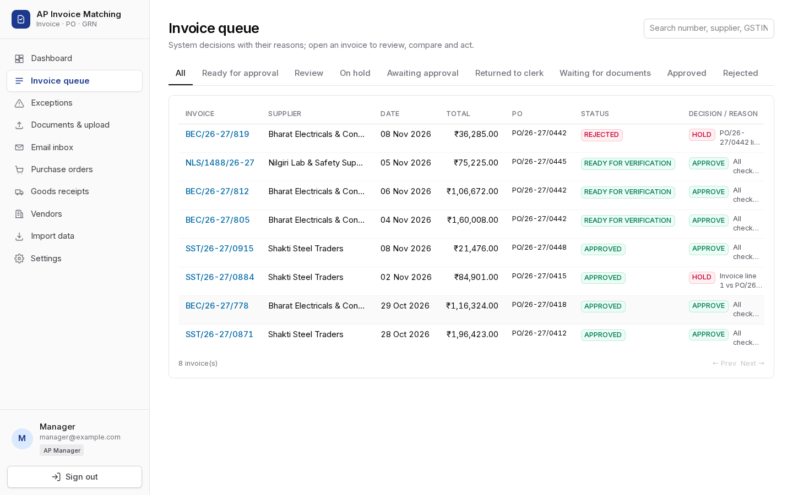
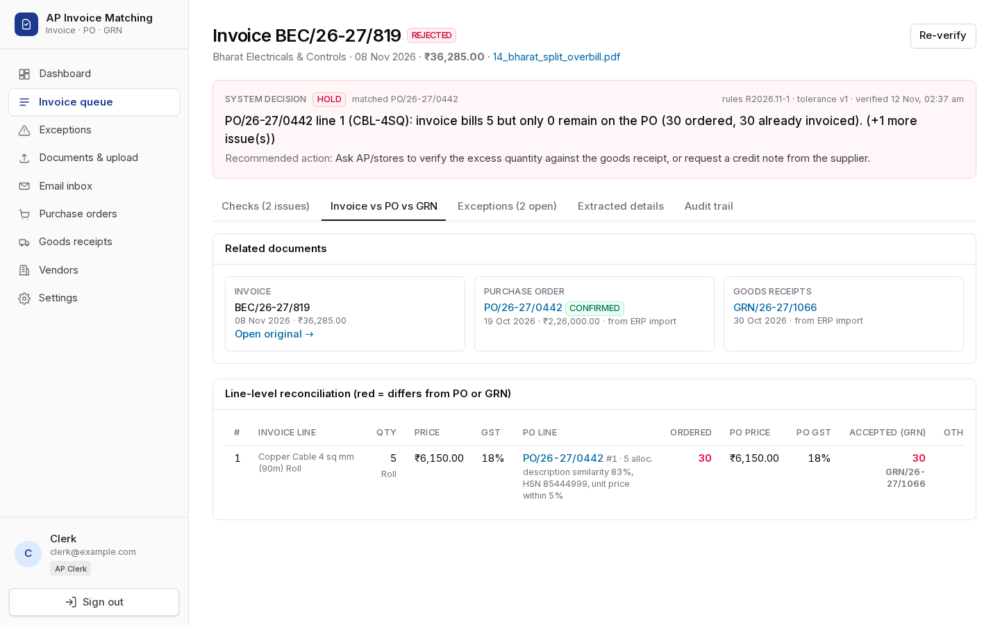

# Invoice Processing & Three-Way Matching

Invoices arrive in any layout, by upload or email, even handwritten. The system reads each one, matches it against its **purchase order (PO)** and **goods receipt note (GRN)**, and gives a clear decision with the reason behind it. People handle the exceptions, and every step is recorded.

- Digital PDFs are read from their own text in seconds. Scans and handwritten bills are read by a **vision model running locally**, so documents never leave the machine.
- Decisions come from **fixed rules**, not AI: the same invoice always gets the same decision, with a written reason.
- Edge cases covered: split billing on one PO, missing or ambiguous PO numbers, duplicates (same file, same number, or re-numbered), unknown vendors, wrong GST rates, goods not yet received, and misread scans ("it knows when it doesn't know").

## 1. Workflow


1. The **admin** sets up users and tolerance rules and keeps the vendor master. Admins and managers import POs and GRNs (the "ERP export").
2. Invoices come in from the **clerk** (upload) or by **email** (the AP mailbox is checked automatically).
3. Each invoice is **checked against its PO and GRN**.
   - **Valid** → *Ready for approval* → the **manager** approves.
   - **Invalid** → the clerk reviews why, checks with the buyer, stores or the supplier, and sends it to the manager with a recommendation to approve or reject. The manager reads the reason and approves, rejects, or **returns it to the clerk**.

### Roles

The roles are kept separate on purpose (segregation of duties), so no single person can both create the documents an invoice is checked against and approve its payment.

| Role | Can do |
|---|---|
| **Clerk** (`AP_CLERK`) | Upload invoices; open the invoice vs PO vs GRN comparison; correct misread fields; pick a PO when it's ambiguous; mark exceptions as checked or resolved, with a note; send for approval with a recommendation. Cannot add POs or GRNs, and cannot approve. |
| **Manager** (`AP_MANAGER`) | Everything a clerk can, plus: import vendors, POs and GRNs; approve (with a reason when going against the system), reject, return to clerk, override; waive exceptions. |
| **Admin** (`ADMIN`) | Everything a manager can, plus users and roles, tolerance rules and vendor extraction profiles. |

| Admin | Manager | Clerk |
|---|---|---|
|  |  |  |
| Settings: tolerance rules (versioned) and users & roles | Invoice queue: every decision with its reason, by status | Reviewing a held invoice: the reason, related documents and line-by-line invoice vs PO vs GRN |

## 2. Code flow: what happens to a document

```
upload / email
      │
      ▼
ingest ──► extract ──► classify ──► parse ──► validate ──► match ──► decision
(store)    (read)      (what is it) (fields)  (own rules)  (PO, GRN) (verdict)
```

Uploads and emails both enter through **ingest**, which stores the file and answers straight away. The rest runs in the background.

| Step | Package | What it does | Example (invoice 02, price above PO) |
|---|---|---|---|
| **ingest** | `service/ingest.go` | Checks the file type by its content (PDF, PNG, JPEG, TIFF), fingerprints it with SHA-256 so exact duplicates are caught, stores it, and marks it "not read yet" | `02_shakti_price_above_po.pdf` saved |
| **extract** | `extract/` | **Digital PDF:** `pdftotext` copies out the text stored inside the file (exact, under a second). **Scan or handwriting:** each page becomes an image for the local vision model, Qwen3-VL through Ollama (a few minutes) | lines like `Invoice No. SST/26-27/0884` |
| **classify** | `classify/` | Decides whether it's an invoice, a PO or a GRN from its title, and checks the type the uploader chose | `INVOICE, 99%` |
| **parse** | `parse/` | Turns the text into fields: invoice number, dates, GSTINs, line items, tax and totals. A rules reading is trusted only if the numbers add up (`reconcile.go`); otherwise the vision model reads the document instead | `items: MS Flat 600 kg @ 74.25 …` |
| **validate** | `validate/` + `gstin/` | Checks the invoice on its own: required fields, GSTIN format and checksum, vendor known and approved, IGST vs CGST + SGST, arithmetic, duplicates | `GSTIN_FORMAT PASS`, `DUPLICATE_INVOICE PASS` |
| **match** | `match/` | Finds the PO (by the printed number, or by searching the supplier's open POs), pairs invoice lines with PO lines, and compares price, tax rate, and quantity against what was ordered, received and already billed | `PRICE_MISMATCH: 74.25 vs PO price 69.75` |
| **decision** | `decision/` | Combines every check into one verdict, in a fixed order: blocked vendor → **REJECT**; duplicate or missing data → **HOLD**; PO or GRN not available yet → **PENDING**; ambiguous PO → **REVIEW**; price, quantity, tax or arithmetic mismatch → **HOLD**; low confidence → **REVIEW**; otherwise **APPROVE** | **HOLD**, with the reason |

After that, people take over: exceptions can be *checked* (explained, still counts), *resolved* (fixed) or *waived* (manager only, no longer counts). The clerk sends the invoice for approval with a recommendation, and the manager approves, rejects or returns it. Decisions made by people are never overwritten by re-checks, and every step is recorded in the invoice's **Audit** tab.

**Documents can arrive in any order.** When a PO or GRN arrives, waiting invoices are re-checked by themselves. Approving or rejecting an invoice re-checks the other invoices on the same PO.

**Email:** the backend checks the AP mailbox over IMAP every `IMAP_POLL_INTERVAL` (e.g. 30s). Every PDF or image attachment of an unread email goes through ingest, exactly like an upload. Emails are remembered by Message-ID, so the same email is never imported twice. A PO or GRN that arrives by email never becomes master data on its own, because anyone can send an email: a manager has to confirm it.

## 3. Technical architecture

```
 browser ──► Next.js frontend (:3000) ──/api/*──► Go backend (:8080) ─────────► PostgreSQL (Neon)
                                                   │
 email (IMAP) ─────────────────────────────────────┤
                                                   │
           main.go: config → open database → migrations → api.RunApp
                                                   │
      Router: login + routes → handlers            │   background goroutines (started in RunApp)
      handlers call service functions              │   dispatcher ──channel──► 2 workers
      and the database                             │     read documents, re-check invoices
                                                   │   email poller
                                                   ▼
                       file storage (Docker volume)      Ollama: Qwen3-VL 4B (local, scans only)
```

- **A request:** route → handler → service function → database → JSON response.
- **Background work:** a dispatcher goroutine sends tasks ("read this document", "re-check this invoice") over a channel to two worker goroutines. The database records what's unfinished: a document waiting to be read keeps a pending status, and an invoice waiting for a re-check is flagged. If the app stops halfway, that work is picked up again on the next start.
- **Dependencies are passed in:** main.go opens the one database connection and loads the one config, then hands them to whatever needs them. Nothing opens its own connection.

| Part | Technology |
|---|---|
| Backend | Go 1.26, Gin, `database/sql` + pgx, golang-migrate (migrations built into the binary, applied on start) |
| Background work | goroutines + a channel inside the backend; unfinished work is recorded in the database (no Redis, no separate worker) |
| Database | PostgreSQL on **Neon** (only `DATABASE_URL` is needed) |
| Files | Local storage in a Docker volume (`invoice-processing_storage`) |
| Reading | Poppler (`pdftotext`, `pdftoppm`); Ollama + Qwen3-VL 4B for scans and handwriting |
| Email | IMAP (`emersion/go-imap`) |
| Frontend | Next.js 16, TypeScript, Tailwind 4 |
| Login | JWT (HS256) and bcrypt; roles checked in the backend |

### Backend files (`backend/`)

**Start-up and web layer**

| File | Contains |
|---|---|
| `cmd/server/main.go` | Program start: load config, open the database, apply migrations, call `api.RunApp` |
| `internal/config/config.go` | Reads settings from the environment (`backend/.env`) |
| `internal/db/db.go` | Opens the PostgreSQL connection and applies migrations |
| `migrations/*.sql` | Database tables, numbered `000001…000007`; new ones apply automatically on start |
| `internal/api/api.go` | `RunApp` (sets up the app, starts background work, starts the HTTP server) and `Router` (every URL, who may call it, and which handler answers) |
| `internal/auth/auth.go` | Login: password hashing, login tokens, `RequireLogin`, `RequireRole` |
| `internal/handlers/handler.go` | The `Handler` struct every handler shares: the app's functions (`Svc`) and the database (`DB`) |
| `internal/handlers/*.go` | One file per area: `auth`, `users`, `dashboard`, `documents`, `vendors`, `procurement` (POs, GRNs, imports), `invoices`, `exceptions`, `tolerances`, `email` |
| `internal/utils/` | Small shared helpers: `response.go` (OK, Bad, Fail), `errors.go` (error kinds → HTTP status), `rows.go` (query rows, paging), `request.go` (id checks), `cors.go`, `logger.go`, `util.go` (rounding, number normalising, financial year, text similarity) |
| `internal/storage/storage.go` | Saves original files to disk (`STORAGE_DIR/YYYY/MM/<uuid>.pdf`) |

**The app: `internal/service/`**

| File | Contains |
|---|---|
| `service.go` | The `Service` struct (file storage, PDF reader, vision model client, config) and `New` |
| `ingest.go` | The single entry point for every file: content check, SHA-256, store, "not read yet" |
| `background.go` | The dispatcher, the channel and the two workers |
| `process.go` | Reading a document: text + rules first, the vision model if needed, then saving the invoice, PO or GRN |
| `verify.go` | Checking an invoice: load it with its POs and GRNs, run validate → match → decision, save the checks and exceptions |
| `actions.go` | What people do: approve, reject, override, return to clerk, send for approval, mark checked, resolve, waive, pick a PO |
| `records.go` | Creating vendors, POs and GRNs; linking GRNs to POs; flagging waiting invoices for a re-check |
| `imports.go`, `tabular.go` | CSV, Excel and JSON imports (column name variations, row errors, templates) |
| `poref.go` | Finding a PO by number even with a small typo (same vendor only) |
| `email.go` | Polling the mailbox and passing attachments to ingest |

**The pipeline packages** (data in, data out; none of them touches the database)

| Package | Files |
|---|---|
| `internal/extract/` | `extract.go` (the PDF's own text via `pdftotext`), `vlm.go` (page images → Ollama → fields) |
| `internal/classify/` | `classify.go` (invoice, PO or GRN from title words), `fuzzy.go` (tolerates misspelled titles) |
| `internal/parse/` | `parse.go` (main reader and totals), `anchors.go` (values next to or under labels), `table.go` (item tables and their columns), `values.go` (numbers and dates), `types.go` (the result types and confidence), `reconcile.go` (do the numbers add up?), `vlm.go` (cleans up and cross-checks the vision model's answer) |
| `internal/gstin/` | `gstin.go`: GSTIN format, check character, near-miss repair |
| `internal/validate/` | `validate.go`: checks on the invoice by itself |
| `internal/match/` | `match.go`: finding the PO, pairing lines, price, tax and quantity checks |
| `internal/decision/` | `decision.go`: the priority order and the written summary |
| `internal/model/` | `model.go`: shared types (invoice, PO, GRN, check) |

**Tools:** `cmd/extractcli` (run reading on one file and print what was found, for debugging), `cmd/samplegen` (generates the test PDFs in `testdata/`).

### Frontend files (`frontend/`)

| File | Contains |
|---|---|
| `next.config.ts` | Forwards `/api/*` from the browser to the Go backend |
| `src/app/layout.tsx` | The page frame: font, login provider, sidebar |
| `src/app/login/page.tsx` | Sign-in page |
| `src/app/page.tsx` | Dashboard: counts by status, open exceptions, recent activity |
| `src/app/invoices/page.tsx` | Invoice queue with tabs (Ready for approval, On hold, Awaiting approval…) |
| `src/app/invoices/[id]/page.tsx` | One invoice: decision and checks, invoice vs PO vs GRN, exceptions, PO match, approve / reject / return / send for approval, audit trail |
| `src/app/documents/page.tsx` | Upload and the list of every document |
| `src/app/documents/[id]/page.tsx` | One document: the original, what was read from it, corrections |
| `src/app/email/page.tsx` | Email inbox: every received email and the documents it created |
| `src/app/exceptions/page.tsx` | All open exceptions |
| `src/app/purchase-orders/`, `src/app/grns/` | PO and GRN lists and detail pages |
| `src/app/vendors/page.tsx` | Vendor master |
| `src/app/imports/page.tsx` | Importing vendors, POs and GRNs (CSV, Excel, JSON) |
| `src/app/settings/page.tsx` | Tolerance rules, users and roles |
| `src/components/Shell.tsx` | The sidebar and the signed-in user panel |
| `src/components/ui.tsx` | Shared pieces: Button, Card, Table, Badge, Tabs, reason dialog |
| `src/lib/api.ts` | Calls the backend with the login token |
| `src/lib/auth.tsx` | Who is signed in, and their role |
| `src/lib/hooks.ts` | `useApi`: load data, refresh while processing |
| `src/lib/format.ts` | Money, dates, labels |

### How to read the code, in order

Follow one upload from start to finish:

1. `backend/cmd/server/main.go`: how the app starts.
2. `backend/internal/api/api.go`: `RunApp` and the route list in `Router`.
3. `backend/internal/handlers/documents.go` → `UploadDocument`: an upload arriving.
4. `backend/internal/service/ingest.go`: the file is stored and marked "not read yet".
5. `backend/internal/service/background.go`: a worker picks it up.
6. `backend/internal/service/process.go`: reading it, using `extract/` → `classify/` → `parse/`.
7. `backend/internal/service/verify.go`: checking it, using `validate/` → `match/` → `decision/`.
8. `backend/internal/service/actions.go`: what the clerk and the manager do next.
9. `frontend/src/app/invoices/[id]/page.tsx`: how all of that appears on screen.

Other folders:

| Folder | What's there |
|---|---|
| `data/demo/` | Demo master data (CSV) and invoices in 5 layouts, including 2 handwritten and the email demo set ([guide](data/demo/README.md)) |
| `data/EDGE_CASES.md` | The edge cases and how each is handled |
| `backend/testdata/` | Fixtures for the automated end-to-end test |
| `scripts/` | `reset_app.sh` (remove everything except the model), `setup_vlm.sh` (vision model check), `e2e_smoke.py` (end-to-end test), `build_demo_set.py` (makes the demo data) |
| `screenshots/` | Images used in this README |

## 4. Setup

Everything runs in Docker, so the only thing to install is **Docker**: [Docker Desktop](https://docs.docker.com/get-docker/) on macOS or Windows (on Windows, run the scripts from WSL2 or Git Bash), or Docker Engine with the Compose plugin on Linux. You also need a PostgreSQL database; a free [Neon](https://neon.tech) project works.

Plan for about **15 GB of free disk** (the vision model and its server are downloaded once) and **16 GB of RAM** (the model is limited to 7 GB).

Nothing else needs installing on your machine. Go, Poppler (`pdftotext` and `pdftoppm`, which the backend uses to read PDFs) and the vision model all live inside Docker images.

### Quick start: `start.sh`

```bash
bash start.sh
```

On the first run it:
1. checks that Docker is installed and running;
2. creates `backend/.env` (and `frontend/.env`) and asks for the database connection string, an admin email and password, and (optionally) a Gmail address and app password for email ingestion. It generates the `JWT_SECRET` itself;
3. downloads the Ollama image and the Qwen3-VL model if they aren't there yet;
4. builds and starts the frontend and the backend.

When it finishes, open http://localhost:3000, sign in as the admin, and create a clerk and a manager under **Settings**.

**Every run of `start.sh` starts clean:** it first runs `scripts/reset_app.sh` (removing the previous run's containers, images, uploaded documents and database data), then builds and starts everything, so you get an empty app with just the first admin. Your `.env` files, `data/`, Ollama and the downloaded model are kept. To start without deleting anything:

```bash
bash start.sh --keep-data
```

| Container | Purpose |
|---|---|
| `frontend` | Next.js UI on http://localhost:3000 |
| `api` | The Go backend on :8080: applies migrations, serves the API, and in background goroutines reads documents, re-checks invoices and polls the email inbox |
| `ollama` | Local vision model server (Qwen3-VL 4B) for scans and handwriting |

### Remove everything: `scripts/reset_app.sh`

```bash
bash scripts/reset_app.sh
```

This cleans the project off your machine and **starts nothing** (it asks you to type `reset` first).

| Deleted | Kept |
|---|---|
| the containers (`api`, `frontend`, `ollama`) and the project's Docker network | the Ollama image and the downloaded model (so the next start doesn't download ~11 GB again) |
| anything else still listening on ports 8080 and 3000 (e.g. a backend from `go run`, a frontend from `npm run dev`) | the `postgres:17-alpine` image (used to empty the database) |
| the images built for this project (`invoice-processing-*`) | `backend/.env`, `frontend/.env` and `data/` |
| uploaded documents (the `invoice-processing_storage` volume) | images you tagged for Docker Hub (`yourname/...`) |
| every app table in the database | Docker's build cache (shared with other projects; clear it with `docker builder prune` if you want) |

`start.sh` runs this automatically before each clean start. `bash start.sh --keep-data` skips it.

### Configuration (`backend/.env` and `frontend/.env`)

`start.sh` fills in the required values. You can also edit the files by hand; see `backend/.env.example` and `frontend/.env.example`.

**`backend/.env`**: everything the Go backend needs.
- **Required:** `DATABASE_URL` (Neon, `sslmode=require`), `JWT_SECRET`, `ADMIN_EMAIL`, `ADMIN_PASSWORD`.
- **Recommended:** `BUYER_GSTINS` (your company's GSTIN) and `GSTIN_CHECKSUM=strict`.
- **Email (optional):** `IMAP_HOST=imap.gmail.com`, `IMAP_USER`, `IMAP_PASSWORD`. For Gmail, turn on 2-Step Verification and create an **App password** at myaccount.google.com/apppasswords.

**`frontend/.env`**: only `BACKEND_URL`, where the frontend forwards `/api` requests (`http://localhost:8080` for `npm run dev`). In Docker it is set at build time to `http://api:8080`, so this file isn't used there.

### Everyday commands

Watch processing and email:
```bash
docker compose logs -f api
```

Stop everything (data is kept):
```bash
docker compose --profile vlm stop
```

Start again:
```bash
bash start.sh
```

Rebuild after code changes:
```bash
docker compose up -d --build api frontend
```

> Never run `docker compose down -v`: it deletes the uploaded files and the downloaded model.

### Run without Docker (for development)

To run the backend straight from source, install these on your machine:
- **Go 1.26** or newer;
- **Poppler**:
  - Fedora: `sudo dnf install poppler-utils`
  - Debian/Ubuntu: `sudo apt install poppler-utils`
  - macOS: `brew install poppler`
- **Node.js 20+**, for the frontend.

The vision model can still run in Docker. It's reachable at `localhost:11434`:
```bash
docker compose --profile vlm up -d ollama
```

Start the backend. It reads `backend/.env`, and `OLLAMA_URL` points it at that local Ollama:
```bash
cd backend && OLLAMA_URL=http://localhost:11434 go run ./cmd/server
```

Start the frontend in a second terminal. It forwards `/api` to `localhost:8080`:
```bash
cd frontend && npm install && npm run dev
```

Then open http://localhost:3000.

### Try it

Follow [data/demo/README.md](data/demo/README.md):
1. Import `vendors.csv`, `purchase_orders.csv` and `goods_receipt_notes.csv` as admin.
2. Upload the invoices as clerk, in number order.
3. Compare each result with the expected decision listed there.

Automated end-to-end test against an empty database:
```bash
python3 scripts/e2e_smoke.py http://localhost:8080
```

## 5. Future updates and other features

**New features**
- **Verify the invoice's QR code.** GST e-invoices carry a QR code signed by the government's Invoice Registration Portal, with the supplier's GSTIN, invoice number, date, total and the IRN (invoice reference number). Reading it would prove the invoice is genuine and registered. It would also give exact values to compare with what was read, catching tampering and misreads.
- **Two-way matching for service orders.** Services (consulting, maintenance, rent) have no goods to receive, so there's no GRN. For those POs, match the invoice against the PO only (price, amount, period), optionally with a manager's confirmation that the service was delivered.
- **Payment reminders.** Work out each approved invoice's due date from its payment terms (e.g. Net 30) and remind the accounts team a few days before, so vendors are paid on time. This matters especially for MSME suppliers, who must legally be paid within 45 days, and for early-payment discounts.

**Next steps**
- **Sync directly with the ERP** (API or scheduled) instead of CSV imports, and hand approved invoices to the payment run.
- **Require a second person to approve:** the person who sends an invoice for approval shouldn't be able to approve it. Add approval limits by amount.
- **Suggest other open POs** when the PO printed on an invoice is already fully billed.
- **Flag changed POs on re-import** (e.g. a price changed), and alert on emails from senders that don't match a known vendor.
- Credit notes, MRNs and e-way bills are stored but not used in matching yet.
- The local vision model takes a few minutes per page on CPU; a GPU or a hosted model would make scans near-instant.
