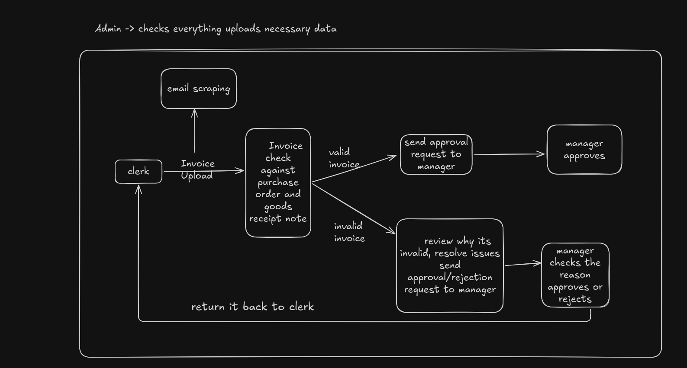
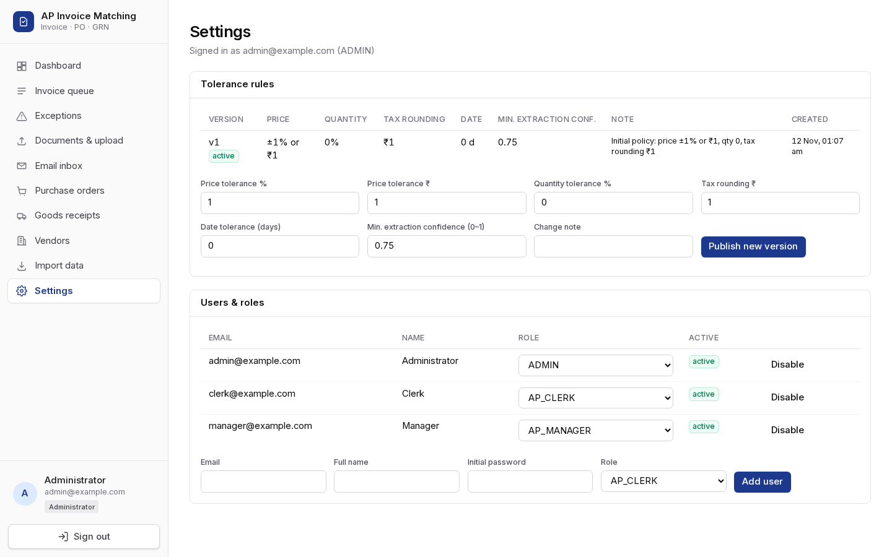

# Invoice Processing & Three-Way Matching

Invoices arrive in any layout, by upload or email, even handwritten. The system reads each one, matches it against its **purchase order (PO)** and **goods receipt note (GRN)**, and gives a clear decision with the reason behind it. People handle the exceptions, and every step is recorded.

- Digital PDFs are read by rules in seconds. Scans and handwritten bills are read by a **vision model running locally**, so documents never leave the machine.
- Decisions come from **fixed rules**, not AI: the same invoice always gets the same decision, with a written reason.
- Edge cases covered: split billing on one PO, missing or ambiguous PO numbers, duplicates (same file, same number, or re-numbered), unknown vendors, wrong GST rates, goods not yet received, and misread scans ("it knows when it doesn't know").

## Workflow



1. The **admin** sets up users and tolerance rules and keeps the vendor master. Admins and managers import POs and GRNs (the "ERP export").
2. Invoices come in from the **clerk** (upload) or by **email** (the AP mailbox is checked automatically).
3. Each invoice is **checked against its PO and GRN**.
   - **Valid** → *Ready for approval* → the **manager** approves.
   - **Invalid** → the clerk reviews why, checks with the buyer, stores or the supplier, and sends it to the manager with a recommendation to approve or reject. The manager reads the reason and approves, rejects, or **returns it to the clerk**.

## Roles

The roles are kept separate on purpose (segregation of duties), so no single person can both create the documents an invoice is checked against and approve its payment.

| Role | Can do |
|---|---|
| **Clerk** (`AP_CLERK`) | Upload invoices; open the invoice vs PO vs GRN comparison; correct misread fields; pick a PO when it's ambiguous; mark exceptions as checked or resolved, with a note; send for approval with a recommendation. Cannot add POs or GRNs, and cannot approve. |
| **Manager** (`AP_MANAGER`) | Everything a clerk can, plus: import vendors, POs and GRNs; approve (with a reason when going against the system), reject, return to clerk, override; waive exceptions. |
| **Admin** (`ADMIN`) | Everything a manager can, plus users and roles, tolerance rules and vendor extraction profiles. |

| Admin | Manager | Clerk |
|---|---|---|
|  |  |  |
| Settings: tolerance rules (versioned) and users & roles | Invoice queue: every decision with its reason, by status | Reviewing a held invoice: the reason, related documents and line-by-line invoice vs PO vs GRN |

## How documents are read

Every document goes through the same entry point (`internal/service/ingest.go`). The file is identified by its content (PDF, PNG, JPEG or TIFF), fingerprinted with SHA-256 (exact duplicates are caught here), stored, and queued. With `EXTRACTION_ENGINE=hybrid` (recommended), the worker then picks one of two paths.

### 1. Digital PDFs: text layer + rules (seconds)
- `pdftotext -layout` gives the PDF's own text with its layout preserved. No OCR is involved.
- Rules classify the document (invoice, PO or GRN) and find fields by their labels ("Invoice No", "Bill No.", "Invoice #", "Dated", "Buyer's Order No.", …). This works whether the value sits next to its label or under it, and handles multi-line table headers, wrapped descriptions, tax split by rate, HSN summary tables and multi-page tables.
- **Reconciliation gate.** The result is only trusted if the document agrees with itself: quantity × rate = amount on every line, the lines add up to the taxable value, CGST + SGST + IGST = the total tax, and taxable + tax + round-off = the grand total. The invoice number must also appear in the text as a whole word. If anything doesn't add up, or a key field has low confidence, the document goes to path 2 instead.
- GSTINs are checked against the vendor master and your own `BUYER_GSTINS`, which also tells the seller apart from the buyer.

### 2. Scans and handwritten bills: local vision model (minutes)
- Each page is rendered to an image (`pdftoppm`) and sent to **Qwen3-VL 4B** through **Ollama**, running locally. The model must answer in a fixed JSON format (every field present, temperature 0).
- The model only **reads**; it doesn't decide. Its output then gets the same treatment as path 1: GSTINs snapped to known ones (up to 3 characters apart), seller and buyer swapped if they're the wrong way round, and line arithmetic checked.
- Every field gets a confidence score. A value the model reports but the document doesn't support gets low confidence, which leads to **REVIEW**. The clerk compares it with the original on the **Extraction** page, corrects it, and the invoice is re-checked automatically.

A misread can therefore send an invoice to review, but never get it approved.

## Checks and decision

- **Validation** (`internal/validate`): required fields; dates; GSTIN format and checksum (`GSTIN_CHECKSUM`); buyer GSTIN; vendor known, approved and not blocked; GST structure (same state: CGST = SGST, different states: IGST); line and total arithmetic; duplicates (same file, same supplier + number + financial year, or same supplier + date + amount under a new number); extraction confidence.
- **Matching** (`internal/match`): the PO comes from the number on the invoice (small typos tolerated), or, if there's none, from a search over the supplier's open POs by items, quantities and prices. One clear match is used, with the reasoning shown; several equal ones go to **REVIEW** for the clerk to pick. Each line is checked for price (within tolerance), GST rate, and **cumulative** quantity: what's already been billed and what was actually accepted across all GRNs. That's how split billing is caught.
- **Decision** (`internal/decision`), in this order of priority: blocked vendor → **REJECT**; duplicate → **HOLD**; missing data → **HOLD**; PO or GRN not available yet → **PENDING**; ambiguous PO → **REVIEW**; price, quantity, tax, arithmetic or vendor mismatch → **HOLD**; low confidence → **REVIEW**; otherwise **APPROVE**. Every check is stored with its expected and actual values and a written reason.
- **Documents in any order:** when a PO or GRN arrives, waiting invoices re-check by themselves. Approving or rejecting an invoice re-checks the others on the same PO.
- **Human workflow:** exceptions can be *checked* (explained, still counts), *resolved* (fixed), or *waived* (manager only, no longer counts). The clerk sends the invoice for approval with a recommendation; the manager approves, rejects or returns it. Decisions made by people are never overwritten by re-checks, and everything lands in the **Audit** tab.

## Email ingestion

The worker checks the AP mailbox over IMAP (`IMAP_POLL_INTERVAL`, e.g. 30s). Every PDF or image attachment of an **unread** email goes through the same entry point as an upload, so the same checks, duplicate detection and audit trail apply. Emails are recorded by Message-ID, so the same email is never imported twice, and they're marked as read once processed. Other file types and signature logos are skipped with a note.

A PO or GRN that arrives by email never becomes master data on its own (anyone can send an email); a manager has to confirm it. The **Email inbox** page lists every email with its sender, subject and the documents it created.

For Gmail, turn on 2-Step Verification, create an **App password** (myaccount.google.com/apppasswords), and set `IMAP_HOST=imap.gmail.com`, `IMAP_USER` and `IMAP_PASSWORD` in `.env`.

## Technical architecture

```
                 ┌──────────── Next.js frontend (:3000) ────────────┐
                 │  dashboard · queues · comparison · audit · inbox │
                 └──────────────────────┬───────────────────────────┘
                                        │ /api/* (proxied)
 upload ─┐                              ▼
         ├──►  Go API (Gin, :8080) ── JWT roles ──► PostgreSQL (Neon)
 email ──┘     │   ▲                                 documents, extractions, invoices,
 (IMAP)        │   │ ingest: content check,          POs, GRNs, checks, exceptions,
               │   │ SHA-256, store, queue           audit events, job queue
               ▼   │
        Go worker (same binary) ── claims jobs (FOR UPDATE SKIP LOCKED)
           │  1. text layer + rules + reconciliation gate
           │  2. else ──► Ollama (Qwen3-VL 4B, local) ── page images
           │  3. validate → three-way match → decision → exceptions
           ▼
        file storage (Docker volume)
```

| Part | Technology |
|---|---|
| Backend | Go 1.26, Gin, `database/sql` + pgx, golang-migrate (migrations embedded, applied on start) |
| One binary | `server api` · `server worker` · `server all` · `server migrate` |
| Job queue | PostgreSQL table with `FOR UPDATE SKIP LOCKED`, retries and stuck-job recovery (no Redis) |
| Database | PostgreSQL on **Neon** (only `DATABASE_URL` is needed) |
| Files | Local storage in a Docker volume (`invoice-processing_storage`) |
| Reading | Poppler (`pdftotext`, `pdftoppm`); Ollama + Qwen3-VL 4B for scans |
| Email | IMAP (`emersion/go-imap`) |
| Frontend | Next.js 16, TypeScript, Tailwind 4 |
| Auth | JWT (HS256), bcrypt; roles enforced in the backend |

```
backend/     Go API + worker (cmd/server), extraction CLI (cmd/extractcli), migrations
frontend/    Next.js app
data/demo/   demo master data (CSV), invoices in 5 layouts incl. handwritten, email demo set
data/EDGE_CASES.md   the edge cases and how each is handled
backend/testdata/    fixtures for automated tests (scripts/e2e_smoke.py)
scripts/     setup_vlm.sh, reset_app.sh, build_demo_set.py, e2e_smoke.py
```

## Setup

Everything runs in Docker, so the only thing to install is **Docker**: [Docker Desktop](https://docs.docker.com/get-docker/) on macOS or Windows (on Windows, run the scripts from WSL2 or Git Bash), or Docker Engine with the Compose plugin on Linux. You also need a PostgreSQL database; a free [Neon](https://neon.tech) project works.

Plan for about **15 GB of free disk** (the vision model and its server are downloaded once) and **16 GB of RAM** (the model is limited to 7 GB).

### Quick start: `start.sh`

```bash
bash start.sh
```

On the first run it:
1. checks that Docker is installed and running;
2. creates `.env` and asks for the database connection string, an admin email and password, and (optionally) a Gmail address and app password for email ingestion. It generates the `JWT_SECRET` itself;
3. downloads the Ollama image and the Qwen3-VL model if they aren't there yet;
4. builds and starts the frontend, API and worker.

When it finishes, open http://localhost:3000, sign in as the admin, and create a clerk and a manager under **Settings**. Running `start.sh` again later just starts everything again: it asks nothing and keeps all data.

### What runs

| Container | Purpose |
|---|---|
| `frontend` | Next.js UI on http://localhost:3000 |
| `api` | Go API on :8080 (logins, uploads, imports, approvals); applies database migrations on start |
| `worker` | Background processing: reads documents (rules or vision model), runs the checks and matching, re-checks waiting invoices, and polls the email inbox |
| `ollama` | Local vision model server (Qwen3-VL 4B) for scans and handwriting |

### Fresh start: `scripts/reset_app.sh`

```bash
bash scripts/reset_app.sh
```

This **deletes all uploaded documents and drops every app table** in the database (it asks you to type `reset` first). Then it brings everything up:
- Ollama and the model are downloaded if missing, or restarted if present.
- The frontend, API and worker are rebuilt and started.
- It reports the status of every container and whether email ingestion is on.

`.env`, `data/` and the downloaded model are always kept.

To (re)build and start everything without deleting anything:

```bash
bash scripts/reset_app.sh --keep-data
```

This is what `start.sh` runs after setting up `.env`.

### Configuration (`.env`)

`start.sh` fills in the required values. You can also edit `.env` by hand; see `.env.example`.
- **Required:** `DATABASE_URL` (Neon, `sslmode=require`), `JWT_SECRET`, `ADMIN_EMAIL`, `ADMIN_PASSWORD`.
- **Recommended:** `EXTRACTION_ENGINE=hybrid` (the default from `start.sh`) and `BUYER_GSTINS` (your company's GSTIN).
- **Optional:** the `IMAP_*` settings for email ingestion.

### Everyday commands

Watch processing and email:
```bash
docker compose logs -f worker
```

Stop everything (data is kept):
```bash
docker compose --profile vlm stop
```

Start again:
```bash
bash start.sh
```

Rebuild after code changes:
```bash
docker compose up -d --build api worker frontend
```

> Never run `docker compose down -v`: it deletes the uploaded files and the downloaded model.

## Try it

Follow [data/demo/README.md](data/demo/README.md):
1. Import `vendors.csv`, `purchase_orders.csv` and `goods_receipt_notes.csv` as admin.
2. Upload the invoices as clerk, in number order.
3. Each invoice's expected decision is listed there.

The edge cases are explained in [data/EDGE_CASES.md](data/EDGE_CASES.md).

Automated end-to-end test against an empty database:
```bash
python3 scripts/e2e_smoke.py http://localhost:8080
```

## Known limits / next steps
  
- **Sync directly with the ERP** (API or scheduled) instead of CSV imports, and hand approved invoices to the payment run.
- **Require a second person to approve:** the person who sends an invoice for approval shouldn't be able to approve it. Add approval limits by amount.
- **Suggest other open POs** when the PO printed on an invoice is already fully billed.
- **Flag changed POs on re-import** (e.g. a price changed), and alert on emails from senders that don't match a known vendor.
- Credit notes, MRNs and e-way bills are stored but not used in matching yet.
- The local vision model takes a few minutes per page on CPU; a GPU or a hosted model would make scans near-instant.
